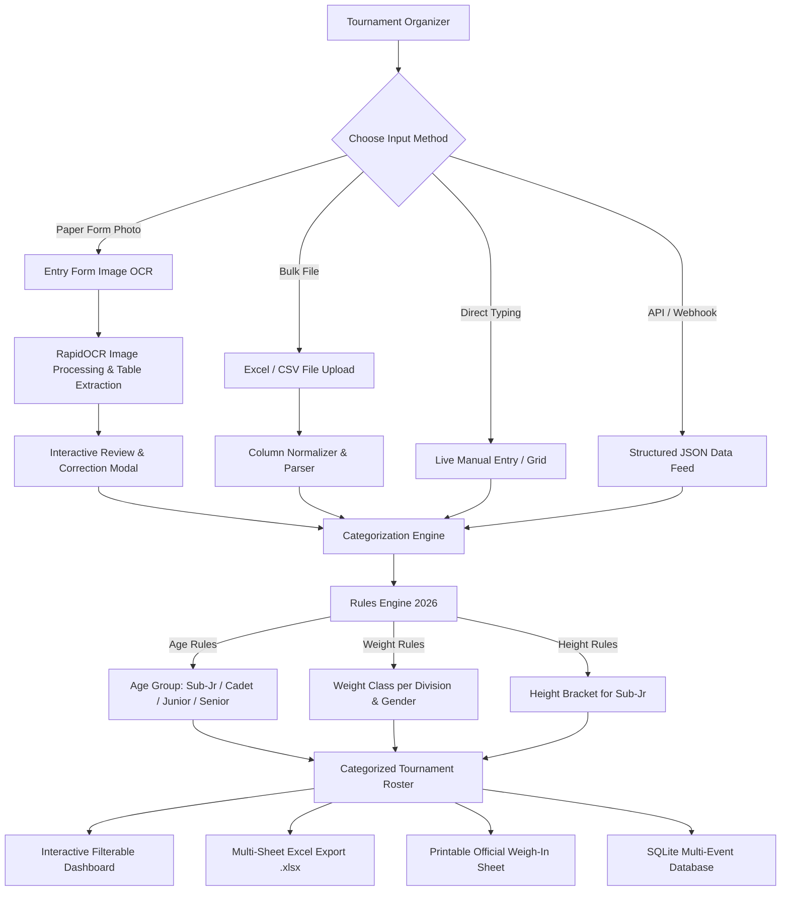

# 🥋 Taekwondo Athlete Categorization System

A high-performance, full-stack tournament classification system built specifically for **real-world district and state level Taekwondo championships** (500 to 2000+ athletes).

Automatically classifies athletes into the correct **Age Division + Weight Class + Height Bracket** with sub-second response times, offline support, computer vision entry form OCR, and tournament weigh-in roster generation.

---

## 🌟 Key Capabilities

1. **Four Versatile Input Channels**:
   - 📊 **Excel / CSV Bulk Upload**: Drag-and-drop parsing of 1 to 2000+ athletes with smart column alias matching (handles Indian formats `DD/MM/YYYY`, `DD-MM-YYYY`, Hindi/English names).
   - 📷 **Entry Form Photo OCR**: Offline deep-learning OCR (RapidOCR with DBNet + SVTR/CRNN) that scans photos of paper entry forms, extracts athlete rows, and displays an interactive review table before importing.
   - ✍️ **Manual Entry (Single Live & Spreadsheet Grid)**:
     - *Single Live Entry*: Reactive preview card that updates division, weight class, and height bracket with every keystroke.
     - *Spreadsheet Grid*: In-browser spreadsheet with clipboard copy-paste from Excel/Google Sheets.
   - ⚡ **Form-type / JSON Data Feed**: Direct API ingestion for online registration forms and event webhooks with real-time response inspection.

2. **Championship Rules Engine (2026 Federation Specification)**:
   - **Sub-Junior**: Born 2015–2019 (~8 to 11 yrs) with 10 weight classes + 12 height brackets (Under 119cm to Over 159cm).
   - **Cadet**: Born 2012–2014 (~12 to 14 yrs).
   - **Junior**: Born 2009–2011 (~15 to 17 yrs).
   - **Senior**: Born 2008 or earlier (18+ yrs).
   - *Dynamic Rules Editor*: Configure custom birth years, weight brackets, and height ranges via UI and API.

3. **Tournament Operations & Export**:
   - 📑 **Styled Multi-Tab Excel Export (.xlsx)**: Generates formatted master rosters, individual tabs per division (Sub-Jr, Cadet, Junior, Senior), and category counts.
   - 🖨️ **Printable Weigh-in & Bouts Sheet**: Formatted official weigh-in sheet with checkmarks and signatures ready for print/PDF.
   - 💾 **SQLite Persistence & Multi-Event**: Local database to manage multiple tournaments and club rosters.
   - ⚡ **High Throughput**: Processes 2,000 athletes in < 0.2 seconds.
   - 📴 **Offline Operation**: Dual-engine architecture—if the backend is offline, the client-side engine continues categorizing locally.

---

## 📐 Architecture & Working Flow



---

## 📋 Age Group & Category Specifications (2026 Event)

### 1. Age Groups

| Division | Birth Years (2026) | Approx Age | Primary Classification Criteria |
| :--- | :--- | :--- | :--- |
| **Sub-Junior** | 2015 – 2019 | 8 – 11 yrs | Weight Class + Height Bracket |
| **Cadet** | 2012 – 2014 | 12 – 14 yrs | Weight Class |
| **Junior** | 2009 – 2011 | 15 – 17 yrs | Weight Class |
| **Senior** | 2008 & earlier | 18+ yrs | Weight Class |

### 2. Sub-Junior Height Brackets (cm)

`Under 119cm` • `119–123cm` • `123–127cm` • `127–131cm` • `131–135cm` • `135–139cm` • `139–143cm` • `143–147cm` • `147–151cm` • `151–155cm` • `155–159cm` • `Over 159cm`

### 3. Weight Classes Overview

- **Sub-Jr Boys**: Under 18kg, 18-21kg, 21-24kg, 24-27kg, 27-30kg, 30-33kg, 33-36kg, 36-40kg, 40-45kg, Over 45kg
- **Sub-Jr Girls**: Under 16kg, 16-19kg, 19-22kg, 22-25kg, 25-28kg, 28-31kg, 31-34kg, 34-38kg, 38-42kg, Over 42kg
- **Cadet Boys**: Under 33kg, 33-37kg, 37-41kg, 41-45kg, 45-49kg, 49-53kg, 53-57kg, 57-61kg, 61-65kg, Over 65kg
- **Cadet Girls**: Under 29kg, 29-33kg, 33-37kg, 37-41kg, 41-44kg, 44-47kg, 47-51kg, 51-55kg, 55-59kg, Over 59kg
- **Junior Boys**: Under 45kg to Over 78kg (10 classes)
- **Junior Girls**: Under 42kg to Over 68kg (10 classes)
- **Senior Men**: Under 54kg to Over 87kg (8 classes)
- **Senior Women**: Under 46kg to Over 73kg (8 classes)

---

## 🚀 Quick Start Guide

### Prerequisites
- **Python 3.10+**
- **Node.js 18+**

### 1. Start Backend (FastAPI)

```bash
cd backend

# On Windows:
python -m venv venv
venv\Scripts\activate

# On Mac / Linux:
python3 -m venv venv
source venv/bin/activate

pip install -r requirements.txt
uvicorn main:app --reload --host 0.0.0.0 --port 8000
```
- API is live at: `http://localhost:8000`
- Interactive OpenAPI Docs: `http://localhost:8000/docs`

### 2. Start Frontend (Next.js)

```bash
cd frontend
npm install
npm run dev
```
- Web Application is live at: `http://localhost:3000`

---

## 📡 API Reference

| Method | Endpoint | Description |
| :--- | :--- | :--- |
| `GET` | `/health` | Health status and service capabilities |
| `GET` | `/demo` | Loads the 11 reference athletes from entry form notebook |
| `POST` | `/sample/generate` | Generates 100–2000 realistic athletes for stress testing |
| `POST` | `/categorize` | Categorize single athlete with instant validation |
| `POST` | `/categorize/bulk` | High-throughput batch categorization (up to 5,000 athletes) |
| `POST` | `/upload/excel` | Excel (.xlsx, .xls) and CSV file upload with smart auto-column mapping |
| `POST` | `/upload/image` | RapidOCR image extraction for entry form photos |
| `POST` | `/export/excel` | Generates downloadable styled multi-tab tournament workbook |
| `GET` | `/rules` | Fetch active tournament age, weight, and height brackets |
| `POST` | `/rules` | Update active tournament rules |
| `POST` | `/rules/reset` | Reset rules to 2026 federation specifications |
| `GET` | `/events` | List all saved events in SQLite database |
| `POST` | `/events` | Create a new tournament event |

---

## 📁 Project Structure

```
taekwondo-categorizer/
├── backend/
│   ├── main.py              # FastAPI server & route handlers
│   ├── rules_engine.py      # Core classification logic & default rules
│   ├── ocr_engine.py        # RapidOCR deep learning table extraction pipeline
│   ├── excel_engine.py      # openpyxl multi-sheet workbook generation & parser
│   ├── sample_generator.py  # Realistic 500-2000 athlete tournament generator
│   ├── database.py          # SQLite database & SQLAlchemy ORM models
│   └── requirements.txt     # Python dependencies
├── frontend/
│   ├── app/
│   │   ├── page.tsx         # Main dashboard & tournament console
│   │   ├── layout.tsx       # Root layout
│   │   └── globals.css      # Styling & theme variables
│   ├── components/
│   │   ├── Navbar.tsx            # Header, event selector & status pill
│   │   ├── SummaryCards.tsx      # Division metric cards & gender progress
│   │   ├── AthletesTable.tsx     # Filterable, sortable, paginated roster table
│   │   ├── ExcelUploadModal.tsx  # Spreadsheet drag-and-drop & templates
│   │   ├── OcrUploadModal.tsx    # Split-view OCR photo review & correction
│   │   ├── ManualEntryModal.tsx  # Live reactive single entry & spreadsheet grid
│   │   ├── DataFeedModal.tsx     # Structured JSON feed testing & ingestion
│   │   ├── RulesConfigModal.tsx  # Tournament rules & brackets customization
│   │   ├── PrintWeighInModal.tsx # Printable official weigh-in sheet
│   │   └── EditAthleteModal.tsx  # Edit athlete modal with live re-classification
│   ├── lib/
│   │   ├── api.ts           # Type-safe API client
│   │   └── rules.ts         # Client-side offline categorization engine
│   └── public/
│       └── entry_form_sample.png # Ready-to-test entry form photo
└── sample-data/
    ├── entry_form_sample.png     # Official sample entry form image
    ├── sample_athletes.csv       # 11 sample athletes from entry notebook
    └── sample_500_athletes.csv   # 500 pre-generated athletes for testing
```

---

## 🧪 Testing & Verification

1. **Test OCR Extraction**:
   - Open `http://localhost:3000`
   - Click **Scan Entry Form (OCR)** → Click **Try Sample Form Photo (1-Click)**
   - Verify that all 7 athletes from the photo are recognized with names, DOBs, weights, and heights, and click **Approve & Add All**.
2. **Test 500-Athlete Stress Test**:
   - Click **Generate 500 (Stress Test)**.
   - Observe instantaneous categorization, summary breakdown, and smooth table pagination.
3. **Test Excel Export**:
   - Click **Export Excel (.xlsx)** to download a styled multi-tab workbook with separate sheets for Sub-Jr, Cadet, Junior, Senior, and Master Roster.
